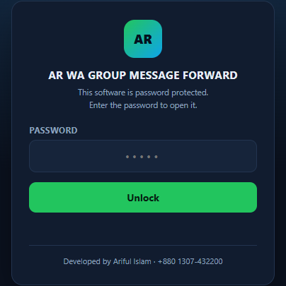

# AR WA GROUP MESSAGE FORWARD

A smart and efficient **WhatsApp Group Message Forwarding Software** for Windows.
It reads new messages from one **source group** and sends the **exact same text** to one
or many **target groups** — automatically, on a daily schedule.

**Developed by Ariful Islam**
Phone: +880 1307-432200 · Email: arifulislam4390@gmail.com

---

## What it does

- Forwards the **original text unchanged** — no prefix, no suffix, no trimming, no
  reformatting. Emoji, Bengali text, digits, spaces and line breaks stay exactly as they
  were received.
- The same message goes to **every selected target group**.
- **Text only.** Images, PDFs, videos, audio, stickers and documents are **never**
  forwarded.
- Messages you send yourself are **not** forwarded (no loops).
- Runs every day only inside a **time window** (default `09:50 – 16:28`). A message that
  arrives outside the window is not sent.
- Optional **daily limit** and **delay between groups** so WhatsApp does not flag the account.
- Password protected start-up screen.
- Forward history, counters, activity log and a **Check now** button that explains why
  something was not forwarded.

## Download

| File | What it is |
|---|---|
| `AR-WA-GROUP-MESSAGE-FORWARD-Setup-1.9.1.exe` | Installer — installs the app and puts a shortcut on the desktop |
| `AR-WhatsApp-Forwarder-Windows.zip` | Portable build — unzip and run, nothing to install |

Both are on the [Releases](https://github.com/ariful66541/ar-wa-group-message-forward/releases) page.

## Screens

| Main window | Password screen |
|---|---|
|  |  |

## Install (for users)

**Option A — Installer (recommended)**

1. Download **`AR-WA-GROUP-MESSAGE-FORWARD-Setup-1.9.1.exe`** from the
   [latest release](https://github.com/ariful66541/ar-wa-group-message-forward/releases/latest).
2. Run it. If Windows shows *"Windows protected your PC"*, click **More info → Run anyway**
   (the build has no paid code-signing certificate).
3. Choose the install folder and press **Install**. A desktop shortcut is created.

**Option B — Portable ZIP**

1. Download `AR-WhatsApp-Forwarder-Windows.zip` from the Releases page and unzip it
   (keep every file together).
2. Run **`AR WhatsApp Forwarder.exe`** — no installer, no extra software needed
   (Windows 10/11 64-bit).

Then:

3. Enter the password to unlock the app.
4. Press **Connect WhatsApp** and scan the QR code with your phone
   (WhatsApp → Linked devices → Link a device).
5. Choose the **source group**, tick the **target groups**, press **Save groups**.
6. Set the schedule and press **Save settings**. Use **Send test message** to try it once.

The WhatsApp login is stored on that PC, so next time it connects automatically.
The app must stay open (and the PC on) for forwarding to work.

## Build from source

Requirements: Node.js 18+ on Windows.

```bash
npm install
npm start                                  # run in development
npm run pack                               # portable folder: release/AR WhatsApp Forwarder-win32-x64
npx electron-builder --win nsis --x64      # installer:      installer/AR-WA-GROUP-MESSAGE-FORWARD-Setup-<version>.exe
```

The portable build is produced with `@electron/packager`; the installer with
`electron-builder` (NSIS, 64-bit, desktop + start-menu shortcuts). Both use the icon in
`build/icon.ico`.

## How it works

`wa-engine.js` tries the `whatsapp-web.js` engine first; if WhatsApp Web's internal
modules change and that engine cannot start, it falls back to `manual-wa.js`, a Puppeteer
engine that drives `web.whatsapp.com` through the user interface:

- opens a chat by clicking its row (or by searching its name),
- types the message line by line (`Shift+Enter` between lines, `Enter` to send),
- reads new messages by walking the message bubble's text nodes, so **one line break in
  the chat becomes exactly one `\n`** — no doubled gaps.

All settings, the session and the log live in
`%APPDATA%\AR WhatsApp Forwarder\`.

## Project layout

```
main.js            Electron main process: windows, IPC, schedule, forwarding, password gate
wa-engine.js       Two-engine orchestrator
manual-wa.js       Puppeteer UI engine (send, read, group list, QR)
preload.js         Safe bridge for the app window
lock-preload.js    Safe bridge for the password window
app/lock.html      Password screen (shown before anything else loads)
app/index.html     App UI
app/renderer.js    App UI logic
build/icon.ico     App icon (installer + window)
```

## Licence

MIT — see [LICENSE](LICENSE).

© 2026 Ariful Islam · All rights reserved.
